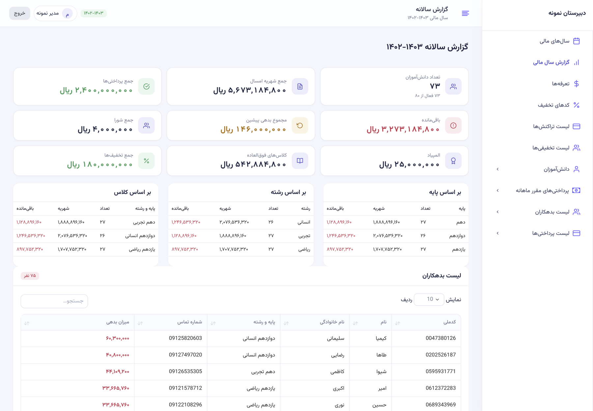
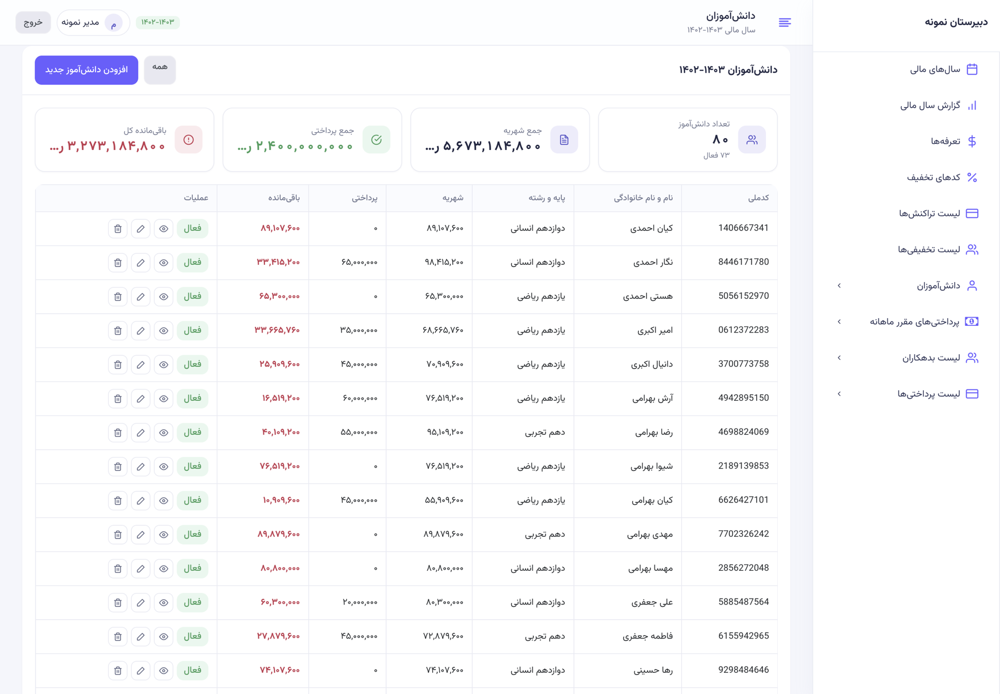
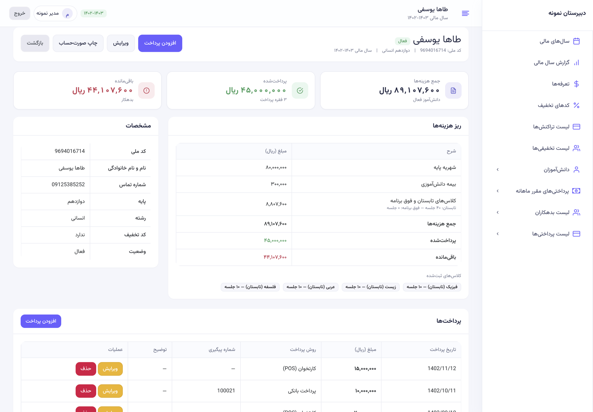
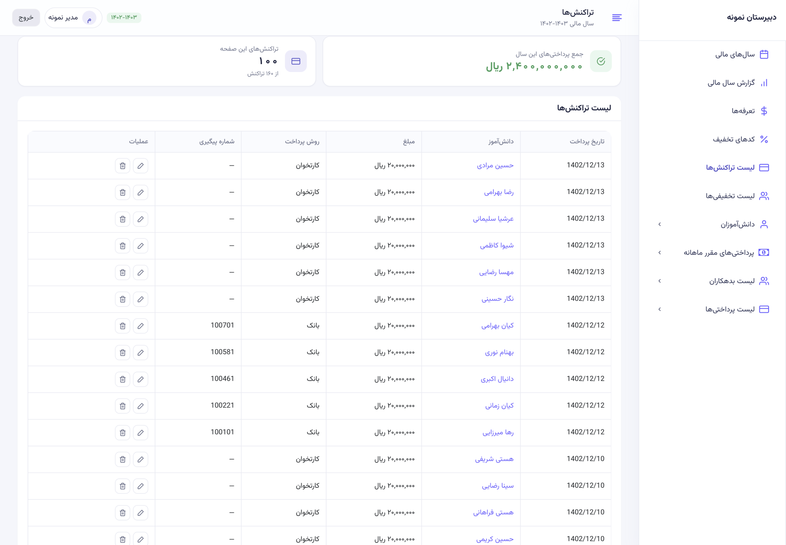
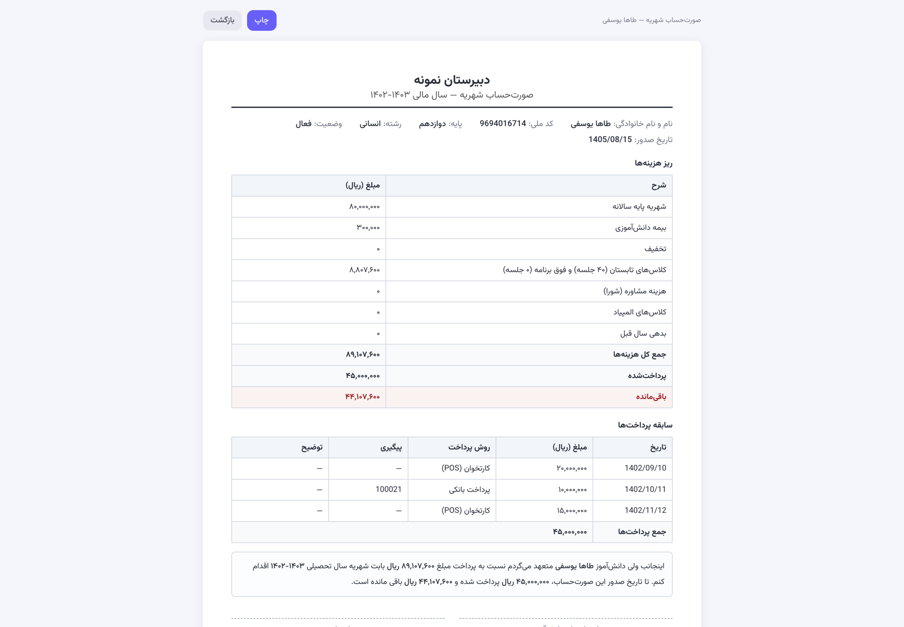

# حسابداری شهریه — School Tuition Management

A tuition and payments system for a Persian high school: financial years, students,
enrolments, discounts, monthly payment agreements, receipts and an annual report —
built as a Laravel rewrite of a real school's 2023 app.

**[فارسی]** نرم‌افزار مدیریت شهریه و پرداخت‌های یک دبیرستان: سال مالی، دانش‌آموزان،
کلاس‌ها، تخفیف‌ها، اقساط ماهانه، صورت‌حساب و گزارش سالانه.



## Why this exists

The school was running a Laravel app written in 2023 that shipped with no
authentication at all — anyone who could reach the port could read every student's
national ID and phone number, and delete a student with a single `GET /delete/{id}`.
The tuition formula was copy-pasted in six places and had already drifted, money was
stored as `varchar`, and the price list used Persian column names (`دهم`,
`ten_summer`), so every new grade meant a migration plus edits in six files.

This repository is the rebuild: same screens, same numbers, new foundation — plus a
one-way importer that proves the rewrite didn't move a single rial.

## What it does

- **Financial years** — several years side by side, each with its own price list.
- **Students** — national ID, grade, field, contact, status; soft-deleted, never
  destroyed together with their payment history.
- **Enrolments** — summer and extra classes per subject, priced per session and grade.
- **Price lists** — base tuition per grade, per-session rates, insurance; rows instead
  of columns.
- **Payments** — POS/bank, Jalali dates (`1402/08/18`), overpayment refused against the
  live balance, soft-deleted, attributed to the staff account.
- **Payment agreements** — monthly commitments (مهر … خرداد), one row per month.
- **Reports** — annual totals, debtors, discounts, olympiad, carried-over debts, plus
  breakdowns **by grade, by field and by class (پایه / رشته / پایه + رشته)**; cached and
  self-invalidating.
- **Printable statement** — A4, per student, charge breakdown and payment history.
- **Roles** — admin, accountant, viewer (read-only); authentication and CSRF on every
  route.
- **Persian digits** — amounts, counts and dates print as ۱۲۳٬۴۵۶ while national IDs
  and phone numbers stay Latin, so they remain copy-friendly.
- **Responsive** — the roster drops to name/class/balance/actions on phones, cards
  reflow to one column, tables scroll instead of clipping.

## Screens

| | |
|---|---|
|  |  |
| Student roster — balances, status, server-side pagination | Student page — charges, payments, commitments |
|  |  |
| Payments — filterable list with totals | Printable statement |

## Quick start (demo data)

```bash
git clone https://github.com/Retro-Zero/school-tuition.git school && cd school
composer install
cp .env.example .env && php artisan key:generate     # set DB_* in .env
php artisan demo:seed                                # fictional data: 80 students
php artisan serve
```

Open <http://127.0.0.1:8000> and sign in with **demo / demo**.

`demo:seed` rebuilds the database with generated students, enrolments, payments and
commitments. **No real student data is in this repository** — names, national IDs and
phone numbers in the screenshots are generated.

## Migrating from the old app

The rewrite ships with the importer that was used for the real migration:

```bash
# .env: V1_DB_* pointing at the old database (read-only connection)
php artisan v1:import              # rebuilds the V2 schema from V1
php artisan v1:import --verify-only
```

`--verify-only` compares V1's own figures against the imported data:

```
students           207                207                OK
active students    203                203                OK
charges (ریال)     15,090,329,060     15,090,329,060     OK
payments (ریال)    5,135,868,360      5,135,868,360      OK
balance (ریال)     9,954,460,700      9,954,460,700      OK
```

Those five numbers were the acceptance criterion: if they match, no student's balance
moved.

## Architecture

```
app/Actions/       one class per write (StoreStudent, RecordPayment, EnsurePriceBook…)
app/Queries/       every read of a roster or the report — filters can't drift
app/Http/Requests/ validation, out of the controllers
app/Policies/      admin / accountant / viewer
app/Import/        V1Importer + ParityReport, usable without the console
app/Services/      Tuition — the only place the money formula exists
app/Support/       Jalali dates, school calendar, asset versioning
routes/web.php     login, financial years, price list
routes/app.php     everything inside a year: /y/{year}/…
```

Design decisions worth knowing:

- **Money is `BIGINT` rial**, never a string. The old data contained a −7,000,000 ریال
  credit, which an unsigned column would have silently corrupted.
- **One tuition formula** (`App\Services\Tuition`) shared by every screen, the report
  and the statement, pinned by unit tests.
- **Reads never write.** `Tuition::forYearId()` used to `firstOrCreate()` a price book,
  so opening a report could INSERT one; creation now belongs to an action.
- **Soft deletes, `RESTRICT` foreign keys** — a student leaves the roster without
  taking their payments with them.
- **RTL done properly**: self-hosted Vazirmatn, `<bdi>` isolation for digit runs
  (`1402-1403` was rendering as `1403-1402`), Persian DataTables strings.

## Stack

Laravel 12 · PHP 8.2 · MariaDB · Blade + Bootstrap 5 · Vazirmatn · PHPUnit · Pint

## Tests

```bash
php artisan test
```

17 tests: the tuition formula (active / inactive / credit carry-over), authentication
and CSRF, and an end-to-end flow — create a student with enrolments, attempt an
overpayment, record a valid one, then soft-delete the student while keeping the payment.

## Deployment

See [`docs/DEPLOYMENT.md`](docs/DEPLOYMENT.md) — Iranian VPS, nginx + php-fpm, nightly
`db:backup` with a restore test, `.ir` domain notes.

## License

MIT
